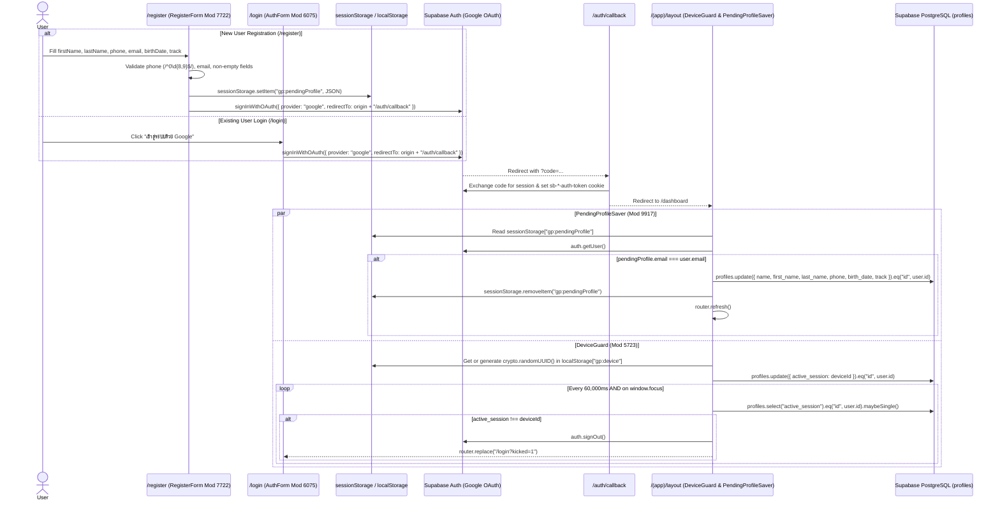

# 03 - Authentication, Registration & Session Security Architecture

All mechanisms below were directly recovered from live chunks (`app/(auth)/login/page`, `app/(auth)/register/page`, `app/(app)/layout`, `app/(marketing)/page`, and `/auth/v1/settings`) (`[OBSERVED]`).

---

## 1. Supabase Auth Configuration (`[OBSERVED]`)
Queried live from `https://wnsgsamwljlkzgtvyssx.supabase.co/auth/v1/settings`:
- **Enabled External Providers**: `google: true`, `email: true` (all others `false`).
- **Signup Policy**: `disable_signup: false`, `mailer_autoconfirm: false`, `passkeys_enabled: false`.
- **Client Auth Mode**: `@supabase/ssr` `createBrowserClient` storing session tokens in HTTP cookies (`sb-wnsgsamwljlkzgtvyssx-auth-token`), readable by both Next.js Middleware/Server Components and Client Components.

---

## 2. Login, Registration & Single-Device Enforcement Flows

---

## 3. Exact Recovered Auth & Security Behaviors (`[OBSERVED]`)

### 3.1 `RegisterForm` Validation Rules (Module `7722`)
- **First & Last Name**: Required (`!firstName.trim() || !lastName.trim()` -> `"กรอกชื่อจริงและนามสกุล"`).
- **Phone**: Strips `-` and spaces, validates `/^0\d{8,9}$/` (9-10 digits starting with `0`, else `"เบอร์โทรไม่ถูกต้อง (เช่น 0812345678)"`).
- **Email**: Validates `/.+@.+\..+/` (`"อีเมลไม่ถูกต้อง"`).
- **Birth Date**: Required date input (`max` = today YYYY-MM-DD, `"เลือกวันเดือนปีเกิด"`).
- **Track**: Select from `["สายอำนวยการ / พิสูจน์หลักฐาน", "ปราบปราม (บุคคลทั่วไป)", "ปราบปราม (ทหารเกณฑ์)"]`.
- **OAuth Handoff**: Saves profile JSON to `sessionStorage['gp:pendingProfile']` and initiates Google OAuth without password.

### 3.2 `DeviceGuard` 1-Device Enforcement (Module `5723`)
- On mount in `(app)/layout`, reads or generates UUID in `localStorage['gp:device']` (validated against `/^[0-9a-f-]{8,64}$/i`).
- Writes `active_session = deviceId` into `public.profiles` if `active_session` is `null` or differs from `deviceId`.
- Polls `profiles.select("active_session")` every `60,000ms` and on `window` `focus` event.
- If another device logs in and overwrites `active_session`, this session immediately executes `supabase.auth.signOut()` and navigates to `/login?kicked=1`.

### 3.3 `signOut` Server Action (Module `6901`)
- Next.js Server Action ID: `00e70b410f4cefb0700a5682c6171d3d8a93181dec` (`createServerReference(..., "signOut")`), invoked via `<form action={signOut}>` in `NavAuthCta`, `MobileMenu`, and `AppMobileMenu`.

### 3.4 `FocusWarmup` (Module `1990`)
- Tracks `document.visibilityState === "hidden"` timestamp; if tab returns after `>= 45,000ms`, triggers `fetch(window.location.pathname, { credentials: "include" })` to refresh SSR/cookie state before user interaction.

