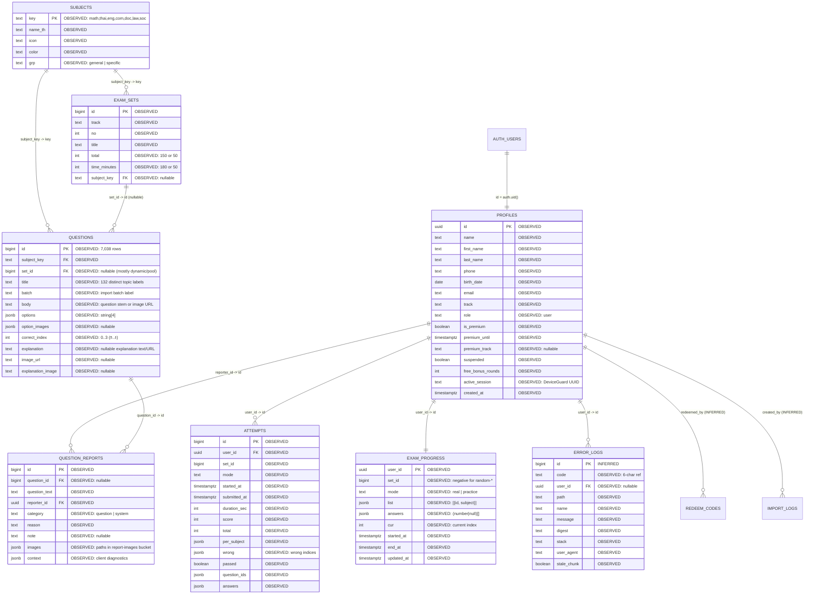

# 04 - Data Models & Entity-Relationship Diagram

Tables and columns marked `[OBSERVED]` were verified via live authenticated PostgREST JSON outputs (`7,038` questions, `4` exam_sets, `7` subjects, `1` profile) and decompiled JS chunks (`Mod 7069`, `Mod 1643`, `Mod 2247`, `Mod 5023`). Columns marked `[INFERRED]` apply to tables with 0 user rows on the observed account.

---

## 1. Entity-Relationship Diagram (Mermaid)

---

## 2. All Discovered Tables & Storage/RPCs (`[OBSERVED]`)

| Resource | Type | Authenticated Result / Purpose |
|---|---|---|
| `subjects` | Table | `7` rows (`math`, `thai`, `eng`, `com`, `doc`, `law`, `soc`) |
| `exam_sets` | Table | `4` rows (`1, 2, 3, 107` — note routes `/exam/101..107` and `/exam/201..215` are dynamically assembled from the `questions` pool!) |
| `questions` | Table | **`7,038` rows** (`100%` extracted with stems, 4 options, `correct_index`, explanations, and 1,386 image URLs) |
| `profiles` | Table | `1` user row (`16` exact columns verified) |
| `exam_progress` | Table | Active exam autosave state (`Mod 7069`, 15s debounce + `keepalive` PATCH on hide) |
| `attempts` | Table | Submitted exam results & per-subject score breakdowns (`Mod 7069`) |
| `question_reports` | Table | Question & system bug reports (`Mod 7069`) |
| `redeem_codes` | Table | Promo/Premium unlock codes; redeemed via RPC `redeem_any_code(p_code)` (`Mod 1643`) |
| `import_logs`, `error_logs`, `leads` | Tables | Admin upload logs, client crash logs (`Mod 5023`), marketing leads |
| `events`, `attendees` | Tables | Shared/legacy Supabase project tables (`HTTP 401` on anon) |
| `report-images` | Storage Bucket | Upload bucket for user bug-report screenshots (`.jpg`, `.png`, `.webp`, max 5MB x 3 files) |
