# 01 - Sitemap & Route Architecture (`examgurupolice.netlify.app`)

> **Build ID (`[OBSERVED]`)**: `lMK9S3c_2qebMoqcgvOv5`
> **Framework**: Next.js 15 App Router deployed on Netlify (`x-powered-by: Next.js`, `server: Netlify`)

---

## 1. Visual Sitemap Diagram

```mermaid
flowchart TD
    Root["/ (Landing Page - (marketing))"]
    
    subgraph Public["Public & Marketing Routes (HTTP 200)"]
        Root --> Articles["/articles (รายการบทความ 20 เรื่อง)"]
        Articles --> ArticleSlug["/articles/[slug] (บทความแนะแนวสอบตำรวจ)"]
        Root --> News["/news (ข่าวสารการรับสมัคร)"]
        News --> NewsSlug["/news/[slug] (ข่าวรับสมัคร 2569)"]
        Root --> Login["/login (เข้าสู่ระบบ Google OAuth)"]
        Root --> Register["/register (สมัครสมาชิก + สายงาน)"]
        Callback["/auth/callback (OAuth PKCE/Code Exchange)"]
        Health["/api/health (JSON Health Check)"]
    end

    subgraph ProtectedUser["Authenticated App Routes - (app) Layout (307 -> /login without session)"]
        Login -->|"Auth Success"| Dashboard["/dashboard (ศูนย์ทำข้อสอบหลัก)"]
        Register -->|"gp:pendingProfile -> Google OAuth -> /auth/callback"| Dashboard
        Dashboard --> Catalog["/catalog (คลังข้อสอบ)"]
        Catalog --> CatalogForm["/catalog/form (ข้อสอบเป็นชุด Google Form Style)"]
        Catalog --> CatalogSubject["/catalog/subject (ฝึกแยกรายวิชา)"]
        Dashboard --> Exam["/exam/[id] (ห้องสอบจับเวลา)"]
        Exam -->|"Submit"| Result["/result/[id] (ผลสอบ & เฉลยละเอียด)"]
        Dashboard --> History["/history (ประวัติการทำข้อสอบ)"]
        History --> Result
        Dashboard --> Reports["/reports (รายงานปัญหาข้อสอบ)"]
        Dashboard --> Profile["/profile (ข้อมูลของฉัน & สายงาน)"]
    end

    subgraph AdminConsole["Admin Routes (307 -> /login without session)"]
        Dashboard -->|"isAdmin"| Admin["/admin (Admin Console)"]
        Admin --> AdminSets["/admin/sets (จัดการชุดข้อสอบ)"]
        AdminSets --> AdminSetsCreate["/admin/sets/create (สร้างชุดข้อสอบ)"]
        Admin --> AdminQuestions["/admin/questions (คลังข้อสอบ Admin)"]
        AdminQuestions --> AdminUpload["/admin/questions/upload (นำเข้าข้อสอบ + import_logs)"]
        Admin --> AdminUsers["/admin/users (จัดการผู้ใช้ & สิทธิ์)"]
        Admin --> AdminCodes["/admin/codes (โค้ด Premium / redeem_codes)"]
        Admin --> AdminReports["/admin/reports (จัดการรายงานปัญหา)"]
        Admin --> AdminAnalytics["/admin/analytics (วิเคราะห์สถิติ)"]
    end
```

---

## 2. Route Discovery Evidence Matrix

| Route Group | Routes | Verification Source (`[OBSERVED]`) |
|---|---|---|
| `(marketing)` | `/`, `/articles`, `/articles/[slug]` (20 slugs), `/news`, `/news/[slug]` (1 slug) | Live `HTTP 200` + HTML/RSC + `_ssgManifest.js` + `href` crawl |
| `(auth)` | `/login`, `/register`, `/auth/callback` | Live `HTTP 200` (`/login`, `/register`), `HTTP 307` (`/auth/callback` missing code error), `RegisterForm` & `AuthForm` chunks |
| `(app)` User | `/dashboard`, `/catalog`, `/catalog/form`, `/catalog/subject`, `/exam/[id]`, `/result/[id]`, `/history`, `/reports`, `/profile` | Live `HTTP 307 -> /login` middleware redirect, `AppNavLinks` (Mod `4625`), `Breadcrumbs` (Mod `375`), `history/page-b089d3fd56d7398b.js` (`HTTP 200`), Next.js BloomFilter |
| `(app)` Admin | `/admin`, `/admin/sets`, `/admin/sets/create`, `/admin/questions`, `/admin/questions/upload`, `/admin/users`, `/admin/codes`, `/admin/reports`, `/admin/analytics` | Live `HTTP 307 -> /login` middleware redirect, `AppMobileMenu` (`adminHref: "/admin"`), `Breadcrumbs` (Mod `375`), Next.js BloomFilter (`/admin`, `/admin/users`, `/admin/reports`, `/admin/questions/upload`) |
| `api` | `/api/health` | Live `HTTP 200` (`{"status":"ok","db":"ok","ms":21}`) |
| Static / PWA | `/manifest.webmanifest`, `/icon.svg`, `/apple-icon.png`, `/favicon.ico` | Live `HTTP 200` from `<head>` `<link>` tags |

