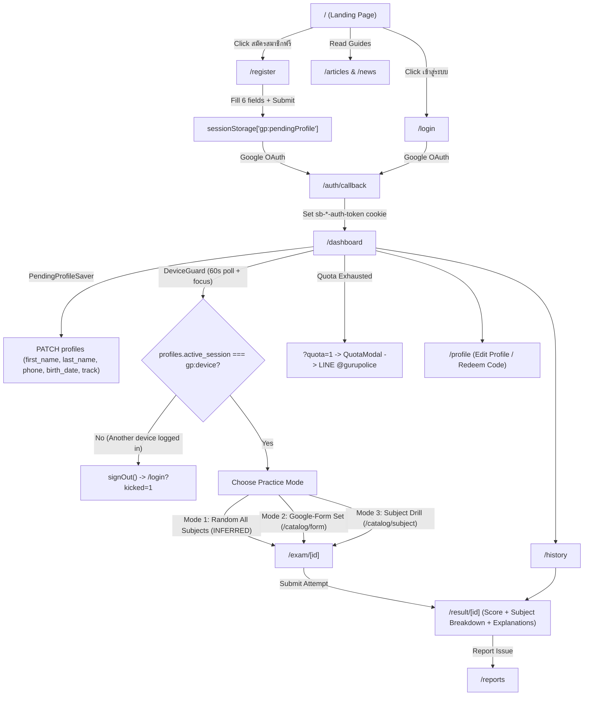
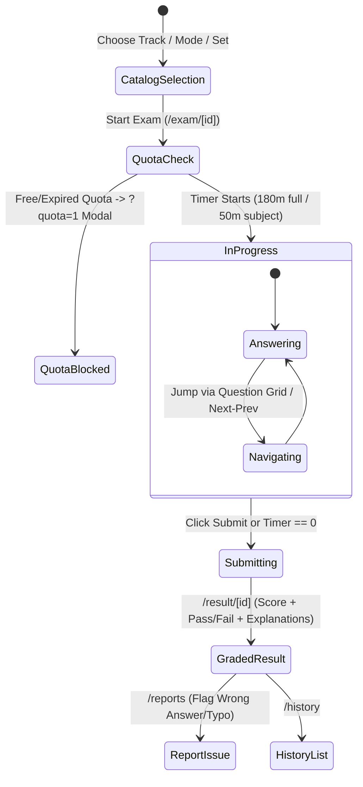
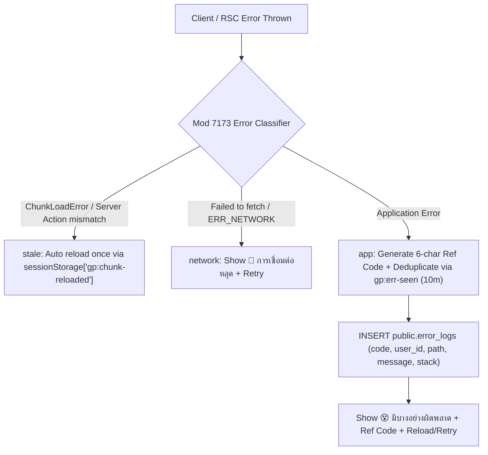

# 05 - User Flows & System State Machines (`examgurupolice.netlify.app`)

Every flow below combines `[OBSERVED]` route transitions, component logic, and FAQ behavior, with `[INFERRED]` server-side transitions labeled explicitly.

---

## 1. End-to-End User Lifecycle Flow

---

## 2. Exam Taking & Review State Machine (`[OBSERVED]` Routes + `[INFERRED]` UI State)

---

## 3. Client Error Recovery State Machine (`[OBSERVED]` in `app/error` & `app/global-error`)

